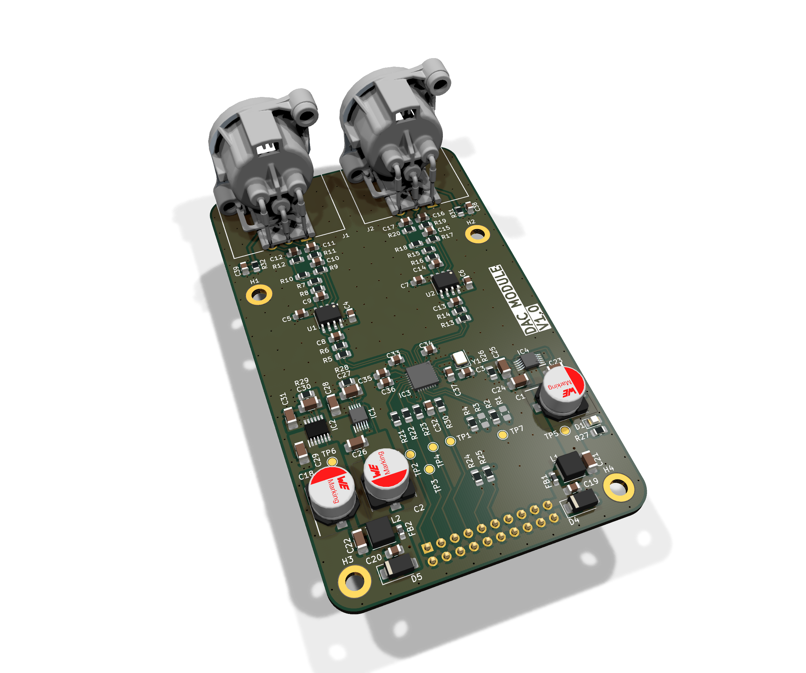
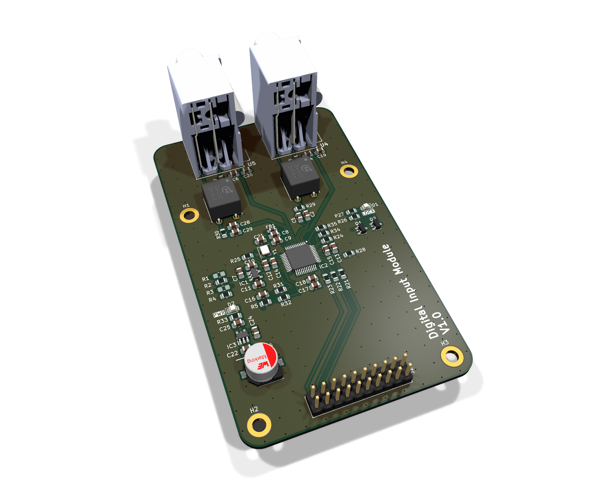

# Audio-Processor

A modular Raspberry Pi based audio processor with custom designed hardware

## Overview
This audio Processor is a home-stereo DSP unit built around a Raspberry Pi 5. The Pi handles input selection, digital signal processing and the touchscreen UI, while all audio input and output happens on custom PCBs designed from scratch in KiCad.

The hardware is modular, every audio module shares the same 60 × 100 mm, 4-layer form factor and a common 20-pin connector carrying I²S audio, I²C control and power. Modules can be added or swapped without redesigning the rest of the system.

## Hardware

### DAC module
A two-channel, balanced-output DAC using the ESS ES9039Q2M chip. High quality components have been chosen for the best possible performance, including the OPA1612 opamps in the output stages and the ultra low noise power regulators used.


<p align="center">
  
</p>


### Digital input module
Receives digital audio from two S/PDIF and tvo coaxial inputs and sends it over I²S to the Raspberry Pi. It is built around the TI SRC4392 IC which handles input multiplexing and sample rate conversion to sync the outgoing data to the Raspberry Pis I²S clock.

<p align="center">
  
</p>

### Power Supply
The power supply converts 230V AC from the wall into voltages used by the rest of the system. These include +5V for the Raspberry Pi, and +-15V for the analog boards.

## Software


## Repository Structure
```
Audio-Processor/
├── Hardware/
│   ├── Digital Input Module/   KiCad project + production files
│   └── DAC Module/             KiCad project, Gerbers, bring-up notes
├── Software/
│   ├── gui/                    Kivy touchscreen interface
│   └── audio_engine/           DSP and hardware control (in progress)
├── docs/                       Diagrams and images
└── LICENSE
```

## Future expansion

## Project Status / Roadmap
Currently the two DAC boards are assembled and initial testing looks promising. An early version of a GUI is up and running on the Raspberry Pi.
My current focus is finishing up the power supply and digital input modules and hopefully getting them ordered soon.

## License
Released under the MIT License.
