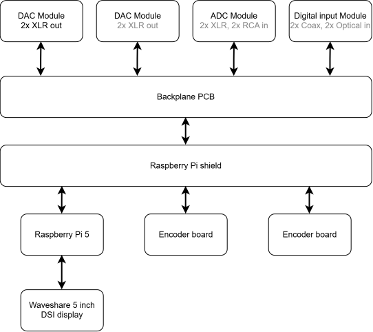

# Audio-Processor

A Raspberry Pi based DSP audio processor for a home stereo system

## Overview

   

## Hardware

## Software

## Repository Structure

## Getting Started

## Project Status / Roadmap

## License
